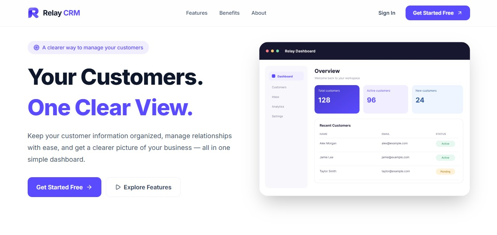
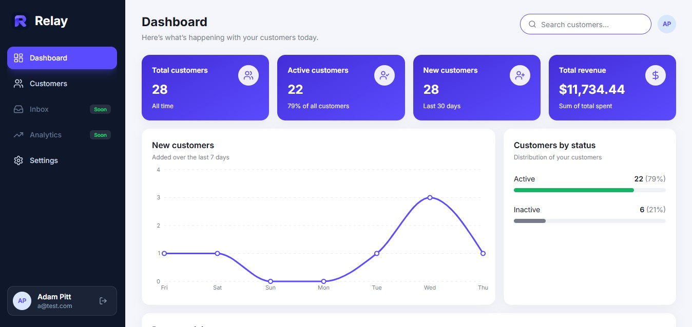
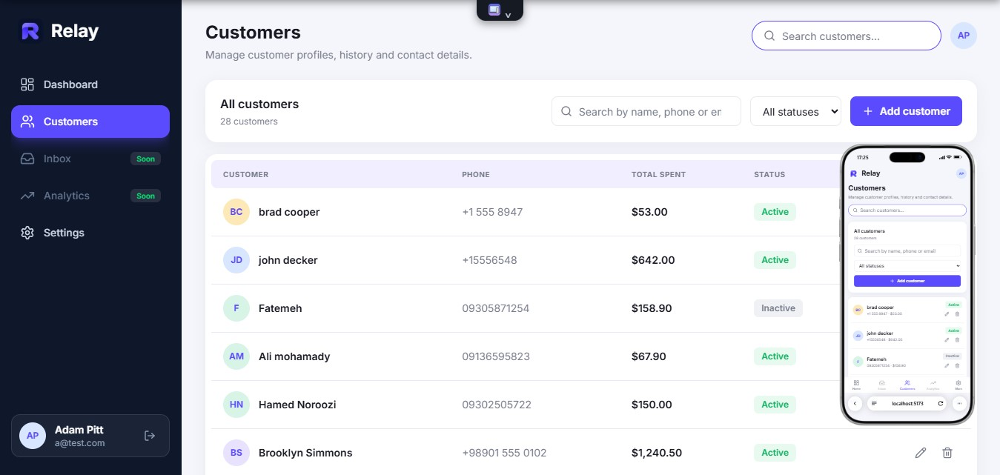
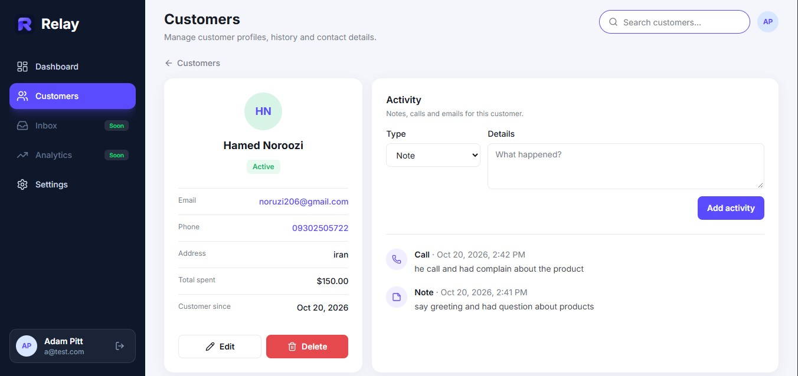
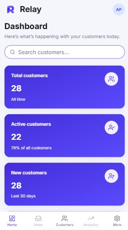

# Relay CRM

A compact customer relationship management app: manage customers, track activity per customer, and see the whole picture on a dashboard. Built with React, TypeScript, Tailwind CSS and Supabase.

**[Live demo](https://relay-crm-six.vercel.app/)** · Built by [Hamed Noroozi](https://github.com/thenoroozi)

<!-- TODO: replace with real screenshots (put the files in docs/screenshots/) -->

| Customers | Customer detail | Mobile |
| --- | --- | --- |
|  |  |  |

---

## Overview

Relay CRM is a portfolio project designed to show how I build a real, data-driven front end end to end: a polished responsive UI, typed data models, a real PostgreSQL database behind it, authentication, and clear separation between UI and data access.

It is intentionally small. The goal was a few features done properly rather than many done halfway.

## Features

- **Landing page** for new visitors, with sign-up and sign-in. Signed-in users who open the site are redirected straight to their dashboard.
- **Authentication** with email and password (Supabase Auth), protected routes, and guest-only routes.
- **Customers**: create, view, edit and delete customers (name, phone, status, total spent, email, address, creation date).
- **Search, filter and pagination** for the customer list. Filters live in the URL, so a filtered view can be refreshed, shared or opened with the back button.
- **Customer detail page** with an activity history for each customer.
- **Dashboard** with summary cards and charts, computed in the database.
- **Settings** page and a user menu.
- **Per-user data**: every account sees only its own data, enforced by the database, not by the UI.
- **Responsive layout** for mobile, tablet and desktop (sidebar on large screens, bottom navigation on small ones).
- **Complete UI states**: loading, error, empty and success states for every data view, plus validated forms with inline errors.

## Tech stack

| Area | Tools |
| --- | --- |
| UI | React 18, TypeScript, Tailwind CSS v4 |
| Build | Vite |
| Routing | React Router |
| Server state | TanStack Query v5 |
| Forms and validation | React Hook Form, Zod |
| Charts | Recharts |
| Icons | lucide-react |
| Backend | Supabase (PostgreSQL, Auth, Row Level Security) |
| Tooling | ESLint (typescript-eslint, react-hooks, react-refresh) |
| Hosting | Vercel |

## Author

**Hamed Noroozi**, front-end developer.

[GitHub](https://github.com/thenoroozi) · [LinkedIn](https://www.linkedin.com/in/hamed-noroozi-570465208/) · [Portfolio](https://portfolio-beryl-nine-42.vercel.app/)
